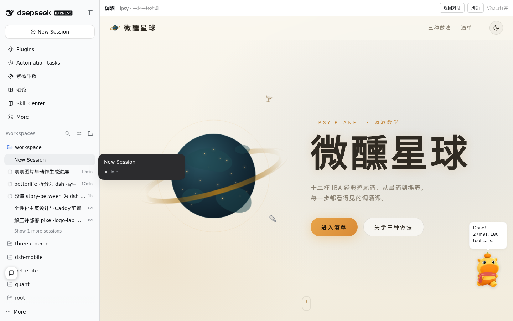

# dsh-bartending

A cocktail reference that opens in the DSH panel: twelve IBA classic recipes, three mixing techniques, and a step-by-step animation for each drink.

**English** · [简体中文](README.zh-CN.md)

[](package.json)
[](LICENSE)



## The problem

Looking up how to make a drink usually costs a new browser tab, a consent banner and a long story before the measurements. This keeps the twelve cocktails you actually mix one click away, in the panel that is already open, with amounts in ml and the steps in order.

## Quick example

The app is a same-origin iframe served from the plugin's own directory; there is no second server and no port to open. Every request passes DSH's login gate first, so the panel inherits the session and the plugin carries no auth code of its own. With a logged-in DSH session:

```console
$ curl -s -H "Cookie: $DSH_COOKIE" http://127.0.0.1:3080/bartending/ | grep -o '<title>.*</title>'
<title>微醺星球 · 十二杯经典调酒指南</title>
```

A card opens at `/bartending/#/cocktail/<id>`: story, ingredients, technique, garnish, ABV and difficulty, plus a stage that animates the build step by step.

## Install

The commands below assume the checkout is at `/opt/dsh/dsh-bartending` — substitute your own path if it lives elsewhere.

```bash
# Preferred: Plugins → Add plugin, paste this repository's path, install,
# switch it on and reload the page. That mounts it live, with no restart.
# Manual equivalent:
dsh plugin --profile web add /opt/dsh/dsh-bartending
# then add "dsh-bartending" to dsh.profile.bundles in the Web profile's package.json
systemctl restart deepseek-harness.service
```

## Usage

1. Open **More** in the DSH sidebar and choose **调酒**. The main panel opens with a toolbar and the site in an iframe.
2. The home page is the recipe grid. Click a card for the detail view. Navigation is hash-based, so the browser's back button works.
3. In the detail view, play or replay the animation, drag the timeline, click a step to jump to it, and switch between the paper and night themes with the moon/sun button in the header.
4. The toolbar keeps **返回对话**, **刷新** and **新窗口打开**; the last two are handy while editing `app/site/`.

## Configuration

Nothing to configure, and no environment variables are read. The fixed facts:

- `/bartending/` is the mount point; `/bartending` gets a 302 to the trailing-slash form, because the app resolves its assets relatively.
- The site directory is resolved from `lib/index.js`, so the plugin works from any install path.
- HTML is sent with `no-cache`; other files get `public, max-age=300`.

## What it doesn't do

- No accounts, no favourites, no history. The only things it stores are the theme and the sound toggle, in `localStorage`.
- The app's theme is its own. Changing the DSH theme does not change the cocktail site, and the animation stage stays dark in both themes.
- The sidebar row depends on the host's `sidebar.panellist.actions` seat. If a DSH upgrade moves that seat, `client.js` needs the new name.
- Twelve fixed recipes: no search, no custom drink, no import.
- Card images and the stage backdrop come from `static.frankfurtlin.top`. Offline the layout still works, but the pictures are missing.
- `app/site/` is a copy of the betterlife page, not the source of truth, and the UI is Chinese only. The Chinese README has the resync command.

## Docs

The long-form notes — layout, design decisions, the acceptance record and how to resync the site — are in the Chinese README: [README.zh-CN.md](README.zh-CN.md).

## Contributing

Issues and pull requests are welcome, including recipe corrections. Run `npm run check` and the Playwright check in `verification/` before sending a patch, and keep the two READMEs in sync when behaviour changes.

## License

MIT. See [LICENSE](LICENSE).
